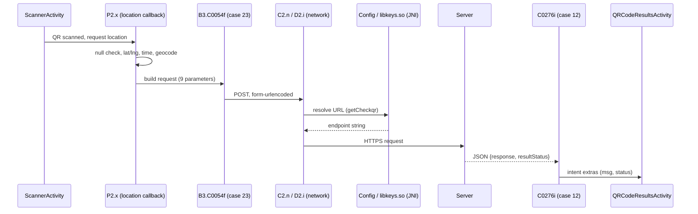

# Static Analysis of an Android QR Check-In Flow

> **Scope:** Client-side static analysis of one production Android app (v1.42.4), done as a learning exercise in codebase exploration, obfuscated-code tracing, and JNI. No servers were contacted, nothing was bypassed, and this document contains no instructions for falsifying check-ins. App name, package, and endpoint are redacted.

## TL;DR

- Scanning a QR code is **not** just `QR → server`. The app also collects **device location, a client-side timestamp, and a reverse-geocoded address** and sends them together.
- The request is a **form-encoded POST** built in an obfuscated class (`B3.C0054f`, case 23).
- The endpoint URL is **not a Java constant**. It is fetched through **JNI** from a native library (`libkeys.so`).
- The server replies with JSON (`response`, `resultStatus`) that the app only **displays**.
- **Server-side validation (geofence, QR expiry, time checks) cannot be determined from the APK.** That is the boundary of this analysis.

---

## 1. Questions investigated

1. Where is the QR scan handled?
2. How is device location obtained, and which values are used?
3. What parameters are sent to the backend?
4. Where does the request go, and how is it constructed?
5. How does the app handle the response?
6. What can and cannot be concluded from the APK alone?

## 2. Setup and tooling

| Item | Detail |
|---|---|
| Artifact | Split APK bundle (`base.apk`, arm64 config split, language split, density split) |
| DEX | `classes.dex`, `classes2.dex` in `base.apk` |
| Native | `lib/arm64-v8a/libkeys.so` in the arm64 split |
| Tools | JADX (decompilation), static string search, native library inspection (JNI exports, embedded strings), archive extraction |

**Why the native lib was in a different APK:** split APKs ship ABI-specific libraries in their own config split, so `libkeys.so` was not in `base.apk`.

## 3. Entry point: the scanner activity

Class names below are obfuscated or renamed; I assigned the roles from behavior.

- `ScannerActivity` is the center of the QR flow.
- User-facing strings show that **location is mandatory** for scanning ("Getting location...", "Location is required to scan QR code...").
- Google Play Services location classes (`LocationRequest`, `LocationResult`) are present, alongside the app's own location service classes.

## 4. Location acquisition

`P2.x` is a success callback that receives the location result.

1. Casts the result to `android.location.Location`.
2. **Null check:** if no location is available, it logs the failure, shows the "location required" message, and stops.
3. Otherwise calls `getLatitude()` / `getLongitude()` and stores them in `ScannerActivity` fields.
4. Builds a timestamp with `SimpleDateFormat("yyyy-MMM-dd HH:mm", Locale.ENGLISH)`.
5. Uses `Geocoder` to turn the coordinates into an address string.

**Takeaway:** the client packages four things, not one.

```text
QR value + device location + client time + derived address  →  server
```

## 5. Request construction

After location is ready, `P2.x`:

1. Shows a "Please wait..." `ProgressDialog`.
2. Gets a request queue (Volley-style).
3. Creates `B3.C0054f` with: the activity, the URL (`Config.f18210j0`), a success callback (`C0276i`, case 12), an error callback (`C0284q`), the QR string, and **switch value `23`**.

`C0054f` is a general-purpose request class: one constructor, many call sites, selected by an integer. Case 23 is the scanner variant. This is typical of obfuscator-merged code and was one of the harder things to spot.

### Parameters sent (case 23)

| Parameter | Source / meaning |
|---|---|
| `eventID` | Event identifier |
| `departmentID` | Department identifier |
| `riderID` | User identifier |
| `qrCode` | Scanned QR value |
| `latitude` | Device latitude |
| `longitude` | Device longitude |
| `time` | Client-generated timestamp |
| `address` | Geocoded address |
| `whichapp` | Organization / app identifier (from string resources) |

## 6. Networking layer

```text
B3.C0054f  →  D2.i  →  C2.n
 (scanner     (response    (base request: method,
  params)      wrapper)     URL, form encoding)
```

- `C0054f` calls `super(1, url, successListener, errorListener)`. Method id `1` is **POST** in this Volley-style library.
- `C2.n` encodes the parameter map as `key=value&key=value...` in UTF-8.
- Content type: `application/x-www-form-urlencoded; charset=UTF-8`. **Not JSON.**

## 7. The endpoint lives in native code

```java
// Config
private static native String getCheckqr();
static { System.loadLibrary("keys"); }
public static final String f18210j0 = getCheckqr();   // used as the request URL
```

- JNI export in `libkeys.so`: `Java_<package>_Config_getCheckqr`.
- Static string extraction from the library revealed the endpoint (a PHP script on the vendor's backend; redacted here).

**Why this matters:** searching the Java sources for URLs would have found nothing. Hiding endpoints in native code raises the effort for casual inspection, but it is obscurity, not protection. The URL still has to exist in memory to make the call.

## 8. Response handling

`C0276i` (case 12):

1. Dismisses the progress dialog.
2. Parses the body as JSON and reads `response` and `resultStatus`.
3. Starts `QRCodeResultsActivity` with these as extras, then calls `finish()` on the scanner.

| Server JSON key | Intent extra |
|---|---|
| `resultStatus` | `msg` |
| `response` | `status` |

The cross-mapping (names swapped) is easy to misread when tracing.

## 9. End-to-end flow



## 10. What was established

| # | Finding | Confidence |
|---|---|---|
| 1 | Location is required to complete a scan | High |
| 2 | Lat/lng taken from the Android `Location` object and stored in activity fields | High |
| 3 | Lat/lng, QR value, time, address, and IDs are all sent to the backend | High |
| 4 | Request is a form-encoded POST | High |
| 5 | Endpoint is resolved via JNI from `libkeys.so` | High |
| 6 | Response is JSON; the app only displays what the server returns | High |

## 11. What cannot be established from the APK

The client shows **what is sent** and **what is done with the reply**. It does not show **how the server decides**. Unknown from this evidence:

- Whether any geofence exists, and its radius or distance formula
- Whether the server compares against stored event coordinates
- Whether QR codes expire, and how that is enforced
- Whether the client timestamp is trusted or checked independently
- Whether the `address` field is used at all
- Whether account, device, or network signals are also checked
- The exact conditions behind each `resultStatus`

These are backend questions, and answering them would require authorized access to the backend. They are out of scope.

## 12. Lessons learned

1. **Obfuscation hides names, not structure.** `P2.x`, `B3.C0054f`, and `C2.n` were readable once I followed call relationships and constructor arguments instead of names.
2. **Merged classes use integer selectors.** One class with a `switch` on a constructor argument can serve dozens of features. Find the argument first.
3. **Native code is a real boundary.** Java-only searches miss anything behind JNI. Check `System.loadLibrary` and `native` declarations early.
4. **Split APKs scatter artifacts.** Native libs and resources can be in config splits, not the base.
5. **Know where the evidence stops.** Client analysis reveals request construction. Server validation logic is a separate system, and claims about it need separate evidence.

## 13. Responsible-use note

This exercise was limited to reading a publicly distributed app's client code for learning purposes. It is not a guide to defeating location or attendance verification. Check an app's terms of service and your institution's policies before analyzing software you do not own, and do not publish endpoints, credentials, or details that would help others abuse a live system.
